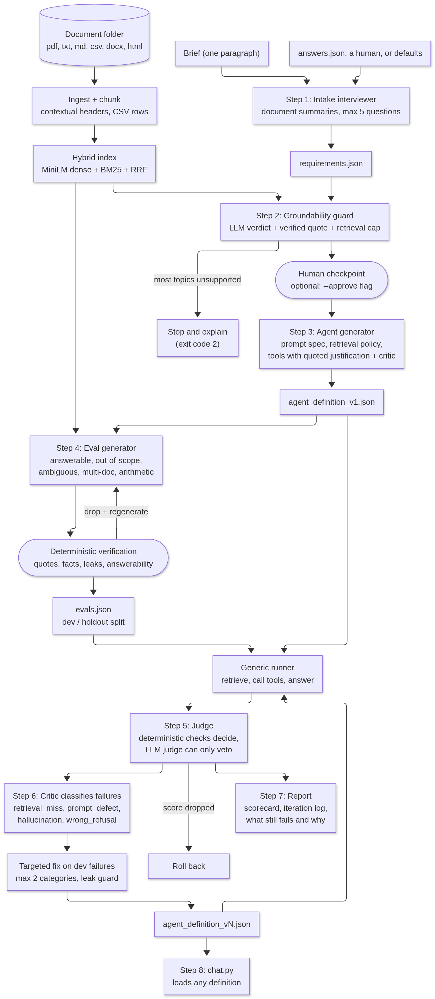

# ForgeAI: the agent that builds agents

ForgeAI takes a **one-paragraph brief** and a **folder of documents**. Running unattended on small local
open models, it produces a **working, tested agent**: system prompt, retrieval configuration, tool
selection, output contract and an auto-generated eval set. It then improves its own output in a
critic-optimizer loop and hands back an **honest quality report**.

It is not a chatbot. It is the machine that interviews the requester, drafts the agent, generates the
tests, judges the results, diagnoses the failures and applies targeted fixes. The design principle
throughout is **distrust the pipeline**: every claim an LLM makes (a quote, a fact, a tool need, a
verdict) is checked by deterministic code before it is allowed to matter.

```
python -m forgeai build --brief "I need an assistant that answers HR policy questions for shore staff" \
                        --docs path/to/docs --out runs/my_agent
python chat.py runs/my_agent/agent_definition_final.json
```

---

## Contents
1. [Architecture](#architecture)
2. [Setup](#setup)
3. [Running the factory](#running-the-factory)
4. [Chatting with a generated agent](#chatting-with-a-generated-agent)
5. [How each requirement is met](#how-each-requirement-is-met)
6. [Demo runs and results](#demo-runs-and-results)
7. [Known limitations](#known-limitations)
8. [Repository layout](#repository-layout)

---

## Architecture



The diagram source is [`docs/architecture.mmd`](docs/architecture.mmd) (Mermaid).

One function, `forgeai.llm.llm()`, makes every model call. It handles both backends, caching, token and
latency accounting per stage, and a per-run log of every prompt and response (`llm_calls.jsonl`).
`llm_json()` adds JSON-mode output, Pydantic validation and **repair-and-retry**: the validation error
is fed back to the model, for up to 3 attempts.

---

## Setup

Requirements: Python 3.10+ and [Ollama](https://ollama.com) (default, fully local), or a Groq API key.

```bash
pip install -r requirements.txt           # on locked-down Windows: python -m pip install -r requirements.txt
ollama pull qwen3:4b-instruct             # generator / agent model (2.5 GB)
ollama pull llama3.2:3b                   # judge: a DIFFERENT model family (self-preference defence)
ollama pull all-minilm                    # all-MiniLM-L6-v2 embeddings (45 MB)
cp .env.example .env                      # Windows: copy .env.example .env
python -m forgeai check                   # preflight: backend reachable, models pulled
python -m pytest -q                       # 32 offline tests (no model needed)
python demos/synthesize.py --regression   # build the demo PDFs (see below)
```

**Demo PDFs are not committed.** The HR policies, the supplier terms and the changed-policy set
(`demos/hr_policy_v2`) are rendered from the committed Markdown in `demos/*/source/` by
`python demos/synthesize.py --regression`. This uses `reportlab` and needs no model; the catalogue CSV is
rebuilt deterministically (seed 2025). Run it once after cloning, before chatting with or re-running the demos.

`.env` settings (see `.env.example`): `LLM_BACKEND` (`ollama` | `groq`), `OLLAMA_MODEL`, `JUDGE_MODEL`,
`EMBED_MODEL`, `OLLAMA_NUM_CTX`, `GROQ_API_KEY`, `GROQ_MODEL`, and `FORGEAI_LLM_CACHE` (on-disk response
cache for fast, reproducible re-runs; `--no-cache` disables it).

Hardware used for the committed runs: laptop with a GTX 1650 Ti (4 GB) and 8 GB RAM. One full build
(24 evals, up to 3 iterations) takes about an hour there. Torch, sentence-transformers and FAISS were
deliberately left out: embeddings come from Ollama (`all-minilm` is all-MiniLM-L6-v2), and an exact
numpy cosine search is instant at this corpus size, so the install stays small and portable.

---

## Running the factory

```bash
# fully unattended (the review scenario): clarifying questions are answered with explicit assumptions
python -m forgeai build --brief "<one paragraph>" --docs <folder> --out runs/<name> --non-interactive

# interactive CLI interview (default when a terminal is attached) + human approval checkpoint
python -m forgeai build --brief-file brief.txt --docs <folder> --out runs/<name> --approve

# reproducible demo: a simulated requester answers the questions from the requester's own notes
python -m forgeai build --brief-file demos/hr_policy/brief.txt --docs demos/hr_policy/docs \
    --out runs/hr_policy --answers demos/hr_policy/answers.json

# options: --max-iters 3  --n-evals 24  --max-tokens N  --max-seconds N  --no-cache
```

Other commands:

```bash
python -m forgeai eval --definition runs/x/agent_definition_final.json --evals runs/x/evals.json \
                       --out runs/x/recheck --compare runs/x/results_iter0.json   # regression mode
python -m forgeai chat runs/x/agent_definition_final.json
python demos/synthesize.py            # rebuild the demo PDFs/CSV (--regenerate re-synthesises the text,
                                      #   --regression builds the changed-policy set demos/hr_policy_v2)
scripts/run_demos.ps1  (or .sh)       # reproduce all committed runs + stretch comparisons
```

Exit codes: `0` built, `1` backend/input problem, `2` **stopped by the groundability guard** (with a
REPORT.md that explains why).

**Web UI (optional):** `streamlit run app.py` opens three tabs: *Factory* (brief + upload or pick a
folder, live build log), *Runs* (reports, scorecards, iteration logs, eval sets of any run) and *Chat*
(talk to any generated agent with its sources and tool calls). It shells out to the same CLI.

**Running a review quickly:** a full build is about an hour on a 4 GB laptop GPU. For a live session use
`--n-evals 20 --max-iters 2` (about 35 min), or point `LLM_BACKEND=groq` at a hosted open model
(minutes). Every stage writes its artifact immediately, so partial progress is always inspectable.

---

## Chatting with a generated agent

```bash
python chat.py runs/hr_policy/agent_definition_final.json
```

`chat.py` is generic: it loads **any** definition, rebuilds its index from `documents_dir` with the
definition's chunking, and runs the same `AgentRunner` the evals use, so what was tested is what you
chat with. Commands: `/sources` (retrieved chunks with scores), `/tools` (tool calls with arguments and
results), `/prompt`, `/reset`, `/quit`.

---

## How each requirement is met

### 1. Intake interviewer (`forgeai/intake.py`)
- **Inspects the folder:** deterministic stats (type, pages, rows, columns, headings) plus a 2-3 sentence
  LLM summary per document.
- **Asks at most 5 clarifying questions** that the brief and docs actually leave open. The cap is enforced
  in code, not trusted to the model. Each question comes with a default assumption.
- **Answers** come from a human at the CLI, from an `--answers` file, or from the default. With an answers
  file, a simulated requester answers: the LLM only *selects* which of the requester's numbered notes
  answer a question, and the answer is those notes **verbatim**. A free-text version was tried first and
  the 4B model invented restrictions the notes never stated, so selection-only is used. Each answer is
  labelled `human`, `requester_file` or `assumed_default`, so the report shows what was assumed.
- Writes `requirements.json` and `requirements.md`: scope, audience, tone, must-answer topics,
  must-refuse topics, the Q&A, and the groundability evidence.

### 2. Groundability guard (`forgeai/groundability.py`)
For every requested topic, three independent signals are combined:
1. an **LLM verdict** (supported / partial / unsupported) that must include a verbatim quote;
2. **quote verification**: the quote must really occur in the retrieved text, or the verdict is downgraded;
3. a **retrieval cap**: low cosine similarity together with low keyword overlap caps the status,
   whatever the LLM says. The LLM can lower a status but never raise it past the cap.

Unsupported topics are moved to must-refuse, flagged as warnings, written into the system prompt's
decline list, and shown at the top of the report. If **most** topics are unsupported the factory
**stops** (exit code 2) instead of generating an agent that would have to hallucinate.

Two refinements found necessary while testing:
- **Brief demands are enforced in code.** A separate call extracts what the brief itself asks for (each
  item verified to consist of the brief's own words), and code guarantees each one is a checked topic.
  Without this, the 4B model listed the documents' table of contents as topics and silently dropped
  "payroll", the one topic the guard most needed to check.
- **Tool-served topics.** A topic the documents cannot support but a registry tool can (e.g. "current
  weather at the next port") is marked `served_by_tool`. After tool selection, the generator reconciles:
  if that tool was not attached, the topic becomes unsupported and is refused.

### 3. Agent generator (`forgeai/generator.py`)
A complete declarative definition (`agent_definition_v*.json`):

| Part | How it is produced |
|---|---|
| System prompt | The LLM writes role, domain rules and answer style (`PromptSpec`). Code renders them into a fixed guardrail template (`prompts/agent_system_prompt.md`): grounding rules, citation format, exact refusal sentence, decline list, partial-coverage list. Invariants are enforced by code, not left for a 4B model to remember. Rules that state numbers absent from the documents are dropped as invented policy. |
| Chunking / retrieval | Deterministic policy from document statistics: long prose gives larger chunks; short list-like text gives smaller ones; CSVs are indexed one row per chunk. Mode is hybrid, top_k is 5 (6 with tables), min_score 0.20. The rationale is stored in `config_rationale`. |
| Tools | For **each** registry tool the LLM decides "needed?" and must **quote the requester's own words** (brief plus human/file answers, never LLM assumptions) that require it. Code verifies the quote, checks preconditions (`csv_lookup` needs a CSV), and then a **skeptical critic pass** (which sees the same document overview and the quoted words) must agree. All decisions, including rejections, are logged in `tool_selection.json`. |
| Output contract | Citations required as `[source: file]`, a fixed refusal phrase (so refusals are machine-detectable), and a word limit chosen by the LLM within 60-250. |

**Tool registry** (`forgeai/tools/`): `csv_lookup` (exact/contains/lt/gt filter on CSVs in the docs
folder), `calculator` (AST-whitelisted, no `eval`), `weather` (Open-Meteo, keyless, with geocoding),
`current_date`. Each has `when_to_use` / `when_not_to_use` text that the generator reads. The runtime
refuses to execute any tool that is not attached to the definition.

### 4. Eval generator (`forgeai/evalgen.py`, prompts `prompts/evalgen_*.md`)
Default 24 cases: 10 answerable (including 2 arithmetic cases when a calculator is attached), 5
out-of-scope (half from must-refuse topics, half plausible-but-absent questions), 4 ambiguous (typos,
indirect, underspecified), and 5 multi-document (chunk pairs from **different** documents matched by
embedding similarity). Passages are sampled round-robin across documents and favour information-dense
chunks.

**Every case is verified deterministically before it is accepted:**
- each quote must occur in its claimed source document. Fuzzy matching tolerates PDF whitespace but
  never a changed number: numbers and IDs must match exactly in the aligned window;
- each expected fact's numbers and IDs must occur in its quote/passage, and its words must overlap;
- multi-doc cases need at least one verified fact from **each** document;
- arithmetic cases: the expression's inputs must come from the passage or question, and the expected
  number is **recomputed by our calculator**, not taken from the LLM;
- out-of-scope questions are dropped if they are too similar to any chunk or if an answerability check
  finds a *verified* answering quote ("secretly answerable");
- questions that leak their own answer, refer to "the passage", or duplicate another question are dropped.

Dropped cases are regenerated for up to 3 rounds. If a type is still short after that (usually
two-document pairs on a small corpus), the set is topped up with single-passage answerable cases, so it
never falls below the requested size (minimum 20). The top-up is noted in the log. Every drop and its
reason is logged in `evals_generation_log.json`; every generation prompt and response is in `llm_calls.jsonl`.

Cases are split deterministically per type: every third case is **holdout**, the rest are **dev**. The
optimizer only ever sees dev failures, so the holdout score shows whether fixes generalise or overfit.

### 5. Judge (`forgeai/judge.py`, rubric `prompts/judge_rubric.md`)
**Deterministic checks decide pass/fail:** expected-fact recall >= 60% (numbers and IDs exact), citation
of an expected source with no citations to unretrieved files, refusal iff should-refuse, and **grounding**
(every number or ID in the answer must appear in the retrieved context, the tool results or the question).

**The LLM judge is secondary and defended against its known failure modes:**

| Failure mode | Defence |
|---|---|
| Position bias | Pointwise scoring against reference facts; the judge never compares two answers. |
| Self-preference | The judge runs on `JUDGE_MODEL` (`llama3.2:3b`, a different family from the `qwen3` agent). The answer is shown with citations and markdown stripped so its style is not recognisable. |
| Verbosity bias | Binary questions about facts only; the rubric states that length earns nothing. Length is measured deterministically and reported separately. |
| Unfounded verdicts | The judge must quote evidence. Quotes are verified, and a verdict without verifiable evidence is discarded. |
| Leniency | **The judge can veto a deterministic pass but can never rescue a fail.** Every disagreement is logged in the report for human audit. |

Agent answers are produced first and judged afterwards, so the two models are not swapped in and out
of the GPU for every case.

### 6. Critic-optimizer loop (`forgeai/optimizer.py`)
Every failure is classified by rules (the LLM judge only breaks the hallucination vs prompt-defect tie):

| Category | Rule | Targeted fix (never a full regeneration) |
|---|---|---|
| `retrieval_miss` | expected passage not retrieved / key facts absent from context / abstained at the gate | ladder: widen (top_k +3, hybrid, lower min_score if abstaining) -> LLM query rewrite -> re-chunk |
| `hallucination` | numbers/IDs not in context, or a verified unsupported claim | stricter number-grounding rule + temperature 0 -> raise min_score + off-topic rule |
| `prompt_defect` | context had the facts but the answer missed them or broke the citation contract | ladder: deterministic completeness rule -> LLM minimal patch (add/modify at most 2 rules) from 2-3 failing examples, applied by code to `PromptSpec.rules` -> a second patch that is told which earlier rules did not help and sees different examples |
| `wrong_refusal` | over-answering (answered an out-of-scope question) or under-answering (refused although the context had it) | over: add generalised refuse topics + scope rule; under: lower min_score + LLM patch clarifying scope |

- At most **2 categories per iteration** (dominant first), so effects can be attributed.
- **Leak guard:** a patch rule that contains expected answer numbers or IDs, restates an expected fact,
  copies an eval question, or weakens grounding is rejected and logged. No teaching to the test.
- **Rollback:** if the dev pass rate drops, the change is reverted (`reverted: regression`). If it does
  not move, it is also reverted (`reverted: no improvement`): with no evidence that it helps, the simpler,
  already-measured definition is kept. Either way the next untried fix is attempted.
- **Stopping:** target reached (90% dev), diminishing returns (a kept change gained < 2 points), no
  untried fix left, budget exhausted (`--max-tokens` / `--max-seconds`), or 3 iterations.
- `iteration_log.md` records what changed (with diffs), why, which cases were targeted, the score
  before and after (overall, dev, holdout), which targeted cases flipped to pass, and which passing
  cases broke.

### 7. Honest reporting (`forgeai/report.py`)
`REPORT.md` contains a headline with baseline vs final and the holdout score, groundability warnings,
tool decisions (including rejections), eval-set statistics with drop reasons, the iteration table,
per-case results, **"What still fails and why"** (each failing case with rule diagnosis, an LLM root-cause
explanation, and the raw question, answer and retrieved sources so the explanation can be checked),
judge-vs-deterministic disagreements, and run-specific known limitations. All numbers are computed
from the result files.

### 8. Runnable product
`chat.py` / `python -m forgeai chat`: see [above](#chatting-with-a-generated-agent).

### 9. Two full demonstrations
See [Demo runs and results](#demo-runs-and-results). Both run folders are committed in full.

### Stretch goals implemented
- **Human checkpoint:** `--approve` shows the requirements and lets the requester accept, edit
  (`requirements.json`, re-validated) or abort before generation.
- **Budget enforcement:** `--max-tokens` / `--max-seconds` per run, exact token counts from the backend
  per stage in `run_stats.json`, and early stopping when an iteration gains < 2 points.
- **Regression mode:** `python -m forgeai eval ... --compare old_results.json` re-runs an old eval set
  against a regenerated agent (or the same agent on changed documents) and writes `COMPARISON.md` (what
  broke, what is newly passing). Demo in `runs/hr_policy/regression_docs_v2/`.
- **Prompt tournament:** `--tournament` generates three candidate system prompts (standard, conservative,
  helpful); the dev split picks the winner (`tournament.json`, comparison table in REPORT.md).
- **Factory vs human baseline:** `scripts/run_stretch.py` scores a hand-written agent on the factory's eval
  set and compares case by case (`runs/hr_policy/handwritten_baseline/`).
- **Web UI:** `streamlit run app.py` (factory, run browser, chat). Not hosted: the factory needs a local
  Ollama or a Groq key, which free hosting tiers do not provide.

---

## Demo runs and results

All numbers below come from the committed run folders via
`python -m forgeai summary runs/hr_policy runs/ship_spares runs/sms_unseen_example`; none are typed by hand.
Each run folder has `REPORT.md` (start there), plus requirements, groundability, tool decisions, every
agent definition version, the eval set with its drop log, per-iteration results, scorecards, the
iteration log with diffs, run stats and `llm_calls.jsonl` (every prompt and response).

| Run | Tools attached | Groundability flags | Evals (dropped) | Baseline | Final | Holdout (final) | Iterations | Stop reason |
|---|---|---|---|---|---|---|---|---|
| `hr_policy` | none | Payroll Credit Dates, Payslip Deduction Explanations | 20 (18) | 19/20 (95%) | 19/20 (95%) | 80% | 0 | dev pass rate 100% reached the target (90%) |
| `ship_spares` | csv_lookup, calculator | Find Container Spares | 24 (2) | 20/24 (83%) | 22/24 (92%) | 83% | 2 | dev pass rate 94% reached the target (90%) |
| `sms_unseen_example` | weather, current_date | Next Due Date Reminder, tell them how many days are left until a report or drill is due | 20 (16) | 18/20 (90%) | 18/20 (90%) | 100% | 3 | reached the maximum of 3 iterations |

"Groundability flags" lists every topic that was not fully supported (unsupported or partial).

### Demo A: HR policy assistant (`runs/hr_policy`, 3 policy PDFs, no tools)
Brief: *"...answers HR policy questions for our shore staff: leave, code of conduct, travel and expense
claims, and payroll questions such as when salaries are credited and what the deductions on a payslip
mean."* The documents deliberately contain **no payroll information**.

- **Groundability guard:** both payroll topics were flagged **unsupported** (the LLM found no evidence and
  retrieval similarity was low), moved to must-refuse, and written into the agent's decline list before
  anything was generated. Leave, conduct, travel approval and expense claims were supported with verified
  quotes.
- **Tools:** none, which is correct for a policy assistant. `calculator` was proposed by the first pass and
  rejected by the critic; `current_date` was rejected because its justification quote did not occur in
  the requester's words (`tool_selection.json`).
- **Evals:** 20 verified cases; 18 generated candidates were dropped by verification (mostly multi-doc
  cases that no longer needed both documents after the fact-relevance check, plus near-duplicates).
  HR's small corpus makes genuine two-document questions scarce, and the drop log shows it.
- **Prompt tournament:** all three candidate prompts passed 15/15 dev cases; the tie-break (fewest
  hallucinations, then fewest wrong refusals, then shortest prompt) picked the conservative one.
- **Optimizer:** not needed. The baseline already passed 100% of dev cases (above the 90% target), so the
  loop stopped without changing anything. The loop's behaviour is shown by the other two runs.
- **Remaining failure (hand-audited):** A09 (holdout). The answer is correct ("1 day of comp-off"), but it
  cited the travel policy, which also states the rule, while the generated case expected the leave policy.
  The citation check is stricter than it should be when a fact appears in two documents. The judge
  flagged the disagreement; by design it could not rescue the case.

### Demo B: ship-spares procurement assistant (`runs/ship_spares`, 152-row CSV + 2 supplier-terms PDFs)
Brief: *"I need an assistant that helps procurement officers find spares, check prices and stock, compare
supplier terms and estimate order costs."*

- **Tools:** `csv_lookup` and `calculator` attached, each with a verified quote ("find spares, check
  prices and stock"; "multiply quantity by unit price ..."). `weather` and `current_date` were rejected.
  In an earlier attempt the critic wrongly rejected `csv_lookup` because it could not see the document
  inventory; the critic now receives the same document overview as the proposer.
- **Groundability:** "find container spares" came out **partial** (guard's reason: no excerpt specifically
  covers container spares; the catalogue is organised by vessel class), so the generated prompt tells the
  agent to say what is not covered.
- **Evals:** 24 verified cases, including 2 arithmetic cases whose expected totals were recomputed by our
  own calculator (e.g. 4 x 459.76 = 1,839.04), plus catalogue lookups and supplier comparisons.
- **Optimizer, 83% -> 92% in 2 kept iterations:**
  - Iteration 1 (`prompt_defect`): deterministic completeness rule. Fixed E01, M02, M04; broke E02, M01;
    net +1, kept.
  - Iteration 2 (`hallucination` + `prompt_defect`): strict number-grounding rule and temperature 0, plus an
    LLM patch. Patch validation rejected one rule because it tried to rewrite an optimizer safety rule. Fixed E02
    and M01; broke E04; net +1, kept. Dev reached 94%, so the loop stopped.
  - The **holdout stayed at 83%** throughout. The gains came on dev cases, which is exactly what the
    holdout is there to reveal.
- **Remaining failures (hand-audited):** M03 is an **eval defect**: the expected dispatch time (2 days)
  belongs to the other supplier, and the agent's answer (3 days for Bluefin) is correct; the LLM root-cause
  explainer wrongly blamed the agent. E04 is mixed: the question is ambiguous between four variants of a
  turbocharger part, and the agent named one of them as "the" part number, which the judge vetoed.
- **Timing caveat:** the laptop went to sleep mid-run, and one call waited about 2.7 hours for it to wake.
  That inflates this run's wall time and the baseline's average latency; the results are unaffected.

### Third run: unseen-style SMS brief (`runs/sms_unseen_example`, 2 text files, not tuned for)
A third domain (ship safety-management procedures) with a brief that also asks for live weather at the
next port and "how many days are left" until a drill is due. It was run unattended without an answers
file, so every clarifying answer is a recorded assumption.

- **Groundability + tools working together:** "current weather at next port" is not in the documents,
  but the guard recognised that the `weather` tool can serve it, so it was **not** wrongly refused.
  `weather` and `current_date` were attached; `calculator` and `csv_lookup` were rejected.
- **Result:** 18/20 (90%), holdout 100%. All three optimizer iterations changed nothing measurable and
  were reverted, so the stop reason is the 3-iteration limit.
- **Remaining failures (hand-audited):** A08 is an **eval defect** (the expected facts include "12 hours",
  which belongs to a different permit type; the agent's "8 hours" is correct). O04 ("what to do if I notice
  a leak in the engine room") was generated as out-of-scope, but the agent's answer, the incident-reporting
  procedure with citations, is defensible. It is a borderline case.

### Stretch: factory vs hand-written baseline (`runs/hr_policy/handwritten_baseline/`)
A manually written HR agent (`demos/hr_policy/handwritten_baseline_definition.json`: its own system
prompt, 700-char chunks, top_k 6, min_score 0.15) was scored on the factory's eval set. **Hand-written
20/20 (100%) vs factory 19/20 (95%).** The hand-written agent won A09, the citation case above; plausibly
because its prompt tells the agent to use and cite both policies when a rule appears in two, though one
case cannot prove that. The factory won no case over it. One case is within noise; the honest summary is "on par, with the human ahead by one case". The
factory's real advantage is everything around the agent: the tests, the coverage warnings and the report.

### Stretch: regression mode (`runs/hr_policy/regression_docs_v2/`)
`demos/hr_policy_v2` changes three policy facts (annual leave 21 -> 22 days, carry-forward 10 -> 8 days,
international per diem USD 60 -> 70; see `CHANGES.md`). The final HR agent was pointed at the new
documents and the **old** eval set re-run with `forgeai eval --compare` (`COMPARISON.md`). Result: 19/20,
nothing broke, and that is the finding: **none of the 20 cases tests any of the three changed facts.**
The same thing happened with an earlier eval set. A regression suite only catches what it covers; the
fix is a diff-aware step that generates new cases for changed chunks (see next steps).

### A bug the generated evals did not catch
Chatting with the final procurement agent by hand, *"What is the unit price and stock of part ME-1042?"*
was refused. Cause: hybrid retrieval fused dense and BM25 ranks with equal weight (RRF), so several
semantically similar catalogue rows outranked the one row containing the exact part number. Fix: an
**exact-identifier boost** (a chunk containing an ID named in the query goes to the top and passes the
score gate; `tests/test_retrieval.py`). After the fix the agent answers correctly (USD 459.76, stock 20,
cited). Re-evaluating all three final agents with the fixed runtime (`runs/*/post_fix_eval/COMPARISON.md`)
changed **no** score: none of the 64 generated cases asked about a part by number in a way that hit
this bug. The committed factory runs were produced before the fix; the re-evaluations show their numbers
still hold. Generated evals are necessary but not sufficient, which is why manual spot checks stay in
the loop.

A second bug was found by a fresh, uncached re-run of the SMS brief while recording the demo video.
Only 2 of 5 two-document pairs survived verification, and the generator stopped after 3 rounds with
**17 cases**, below the required 20. Only some shortfalls (arithmetic cases, corpora with no pairs) were
being refilled. Fix: a final top-up with answerable cases whenever the total is below the target
(`tests/test_evalgen_verification.py::test_set_is_topped_up_to_the_minimum_when_a_type_stays_short`).
The committed runs were not affected: they have 20, 24 and 20 cases.

### What a hand audit of all remaining failures shows
Across the three runs, 5 cases still fail. By hand: **1 real agent weakness** (E04, overconfident on an
ambiguous part), **3 eval-generation defects** (an expected fact belonging to a neighbouring record or the
other supplier, or a citation expectation that is too narrow), and **1 borderline case**. The automated
pass rates are therefore slightly pessimistic. They are still the numbers reported, because a factory
that quietly corrects its own scores is not trustworthy. The main lesson matches the brief: on small
models the weakest link is the generated eval set itself, which is why every expected fact is verified
against the documents and every judge/rule disagreement is surfaced for a human.

---

## Known limitations

- **Small models, small eval sets.** 24 cases means one case moves the score about 4 points, and the
  holdout has only about 6. Treat differences of 1-2 cases between iterations as noise.
- **Generated evals share blind spots with the generator.** Verification guarantees that expected facts
  are really in the documents. It does not guarantee the questions are representative of real users.
- **Lexical fact matching.** Numbers and IDs must match exactly and words must overlap. Heavy
  paraphrases can fail, which is why judge disagreements are listed for audit. The judge itself is a
  3B model and only trusted when it quotes verifiable evidence.
- **The grounding check flags all novel numbers,** including correct mental arithmetic, and ignores the
  counting numbers 0-3.
- **Live tools** (weather, current date) cannot be checked by a static eval set; only tool routing is
  exercised.
- **The retrieval/chunking policy is heuristic** (document statistics), not learned. The optimizer can
  change it, but only along a fixed ladder.
- **Embedding truncation:** all-MiniLM embeds at most 256 tokens, so the tail of a long chunk is only
  reachable through BM25.
- **Demo documents are synthetic** (see `demos/synthesize.py` for provenance). Real policy PDFs with
  tables, scans or complex layouts would need better extraction (OCR, table parsing).

### What I would do next
1. **Diff-aware regression:** when documents change, detect the changed chunks and generate targeted
   eval cases for them, so regression mode tests what actually changed (see the regression result above).
2. **Stronger expected facts:** an extra verification step that the expected facts answer *this*
   question (HR A03 shows the relevance filter can miss a neighbouring fact). Optionally a quick human
   review of the generated eval set (`--approve` already exists for requirements).
3. **Bigger eval sets with repeated runs** to put confidence intervals on pass rates, so the optimizer
   can tell a real gain from noise instead of relying on +/-1 case.
4. **A stronger judge model** when hardware allows; the 3B judge is often too lenient, which is why it
   is only allowed to veto.
5. **Templated eval cases for tables:** for CSV sources, also generate "look up row by its ID" questions,
   which would have caught the exact-identifier retrieval bug automatically.
6. **Citation check that accepts any supporting document:** a citation should count when the cited
   source really contains the fact, not only when it is the document the case was generated from (HR A09).

---

## Repository layout

```
forgeai/
  llm.py            single LLM entry point: backends, JSON repair-and-retry, cache, stats, embeddings
  schemas.py        all Pydantic models (artifacts + small per-call LLM output schemas)
  textutil.py       deterministic checks: numbers/IDs, quotes, fact matching, refusal detection
  ingest.py         loaders (pdf/txt/md/csv/tsv/docx/html/json) + heading-aware chunking
  retrieval.py      dense (MiniLM via Ollama) + BM25 + reciprocal rank fusion, exact-ID boost, min_score gate
  tools/            registry + csv_lookup, calculator, weather, current_date
  intake.py         R1 interviewer          groundability.py  R2 guard
  generator.py      R3 agent definition     evalgen.py        R4 generated + verified evals
  judge.py          R5 judge + failure taxonomy
  optimizer.py      R6 critic-optimizer loop with leak guard and rollback
  report.py         R7 scorecards + REPORT.md
  runner.py         R8 generic agent runtime (shared by chat and evals)
  factory.py, cli.py, chat.py
prompts/            every prompt the factory uses (generation, eval generation, judge, optimizer)
demos/              hr_policy/, ship_spares/, brief_unseen_example/, synth_prompts/, synthesize.py
runs/               committed artifacts of the demo runs
tests/              offline tests (LLM mocked)
docs/               architecture diagram (PNG + Mermaid source)
chat.py             python chat.py <agent_definition.json>
```
